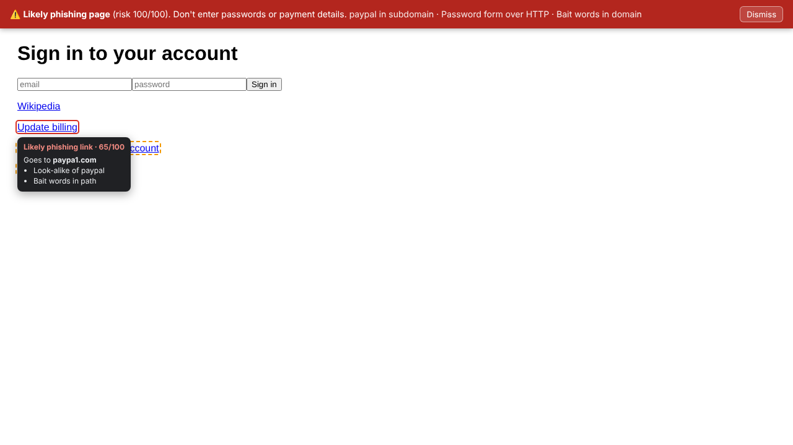
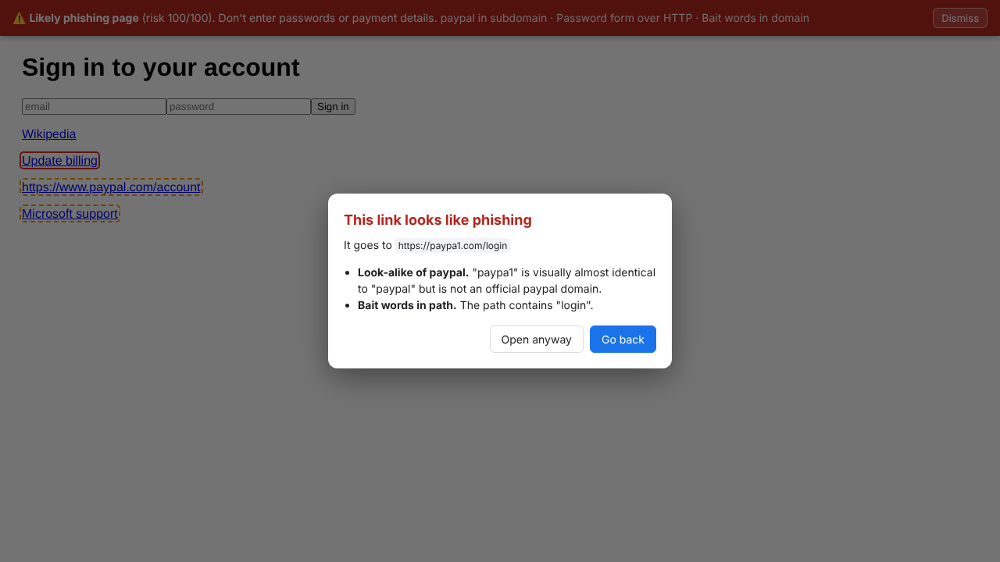
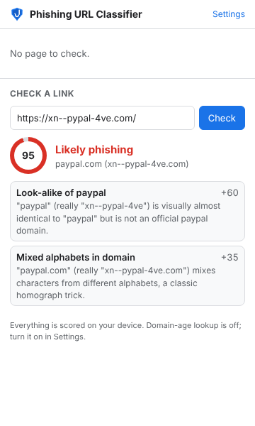

# Phishing URL Classifier

[](https://github.com/DaveyD347/phishing-url-classifier/actions/workflows/ci.yml)
[](LICENSE)


A Chrome and Firefox extension that scores links and pages for phishing risk **in real time, on your device**. It catches typo-squats (`paypa1.com`), homograph attacks (`pаypal.com` with a Cyrillic "а"), brand names buried in subdomains (`paypal.com.account-verify.xyz`), disguised IP addresses, deceptive link text and more, and explains every verdict in plain language.

No account, no tracking, no remote scoring service. The whole classifier is about 700 lines of dependency-free JavaScript you can read in one sitting.

| Risky links are outlined and explained on hover | Dangerous links ask before opening |
|---|---|
|  |  |

<p align="center"></p>

## Features

- **Toolbar badge** for every page you visit: `!` for likely phishing, `?` for suspicious.
- **Warning banner** across the top of likely phishing pages.
- **Link scanning**: every link on a page is scored; risky ones get a red or amber outline with a hover tooltip saying why. Links added later (single-page apps, infinite scroll) are picked up by a `MutationObserver`.
- **Click guard**: following a dangerous link opens a confirmation dialog first.
- **Deceptive link text detection**: `<a href="https://evil.example">https://www.paypal.com</a>` is flagged.
- **Password-over-HTTP detection**: the content script tells the scorer when a page has a password field.
- **"Check a link" box** in the popup for URLs you get in email or chat.
- **Per-user allowlist** for internal sites.
- **Optional domain-age lookup** over RDAP (off by default; see [Privacy](#privacy)).
- **TLS certificate state** on Firefox, via `webRequest.getSecurityInfo`.
- All injected UI lives in a **closed shadow root**, so hostile page CSS can't hide or restyle the warnings.

## Install

### From a release (recommended)

1. Download the zip for your browser from the [latest release](https://github.com/DaveyD347/phishing-url-classifier/releases/latest).
2. **Chrome / Edge / Brave:** unzip it, open `chrome://extensions`, turn on **Developer mode**, click **Load unpacked** and pick the unzipped folder.
3. **Firefox:** open `about:debugging#/runtime/this-firefox`, click **Load Temporary Add-on…** and pick the zip (or any file inside it). Temporary add-ons are removed when Firefox restarts; a signed build for permanent install is on the roadmap.

### From source

```bash
git clone https://github.com/DaveyD347/phishing-url-classifier.git
cd phishing-url-classifier
```

- **Chrome:** load the `extension/` folder with **Load unpacked** as above. No build step needed.
- **Firefox:** run `npm run build` (Node 20+, no `npm install` needed) and load `dist/firefox/manifest.json` as a temporary add-on.

## How scoring works

Each heuristic emits *signals* with a weight. The score is the sum of the weights, capped at 100.

| Score | Verdict | What you see |
|---|---|---|
| 0–24 | Safe | nothing |
| 25–59 | Suspicious | amber `?` badge, dashed amber outline on links |
| 60–100 | Likely phishing | red `!` badge, page banner, red outline and click guard on links |

Domains owned by the brands in [`brands.js`](extension/engine/brands.js), and anything on your allowlist, are marked **trusted** and skip scoring.

### Signals

| Group | Signal | Weight | Example |
|---|---|---:|---|
| **Look-alikes** | Homoglyph of a brand | 60 | `paypa1.com`, `arnazon.com`, `pаypal.com` |
| | Typo-squat (edit distance 1, or 2 for long names) | 40 | `netfliix.com`, `micosoft.com` |
| | Brand in subdomain | 35 | `paypal.com.account-verify.xyz` |
| | Brand combined with other words | 30 | `secure-paypal-login.top`, `appleid-verify.com` |
| | Brand glued into the name | 20 | `paypalsecure.com` |
| | Brand named in path on another site | 10 | `example.net/paypal/login` |
| **Host form** | Disguised IP (decimal / hex / octal) | 45 | `http://3232235777/` |
| | Raw public IP address | 35 | `http://45.33.32.156/login.php` |
| | Mixed alphabets in one label (IDN homograph) | 35 | `xn--pypal-4ve.com` |
| | `user@host` trick | 30 | `https://www.google.com@evil.example/` |
| | Internationalised (punycode) domain | 10 | `xn--mnchen-3ya.de` |
| **Scheme & transport** | `data:` / `javascript:` / `blob:` URL | 60 | `data:text/html;base64,…` |
| | Certificate invalid (Firefox) | 40 | |
| | Password form over HTTP | 25 | |
| | Plain HTTP | 15 | |
| | Weak TLS (Firefox) | 10 | |
| | Non-standard port | 10 | `:8080` |
| **Domain shape** | High-abuse TLD | 15 | `.xyz`, `.top`, `.zip`, `.tk` |
| | Random-looking (entropy + digits / consonant runs) | 15 | `x7kq9zpl2vmw3r.top` |
| | Bait words in domain (10 each, max 20) | 10–20 | `secure-login-verify` |
| | Many subdomains | 10–20 | `a.b.c.d.example.com` |
| | Free hosting / tunnel platform | 10 | `*.web.app`, `*.ngrok-free.app` |
| | Many hyphens | 10 | `secure-account-update-now.com` |
| | URL shortener | 10 | `bit.ly` |
| **URL shape** | Risky file download | 15 | `.exe`, `.scr`, `.hta`, `.iso` |
| | Very long / long URL | 5–10 | |
| | Embedded redirect URL | 10 | `?next=https://…` |
| | Bait words in path (5 each, max 10) | 5–10 | `/webscr/verify` |
| | Heavy percent-encoding | 5 | |
| **Page context** | Link text shows a different domain | 35 | text `paypal.com`, href `evil.example` |
| | Domain registered < 7 / < 30 / < 180 days ago (opt-in) | 40 / 30 / 15 | |

### Look-alike detection, in a little more depth

The registrable label (`paypa1` in `login.paypa1.co.uk`) is reduced to a **visual skeleton**: Unicode is NFKD-normalised and stripped of accents, then digits and Cyrillic/Greek homoglyphs are mapped to the Latin letters they imitate (`1→l`, `0→o`, `а→a`, `ο→o`), and multi-letter look-alikes are collapsed (`rn→m`, `vv→w`). The skeleton is compared with each brand label by exact match, then by optimal-string-alignment edit distance, which counts a swap of neighbouring letters (`paypla`) as one edit. Brand labels shorter than 5 characters (`ups`, `irs`, `dhl`) are only matched exactly, to avoid flagging `cups.org`.

Registrable domains are computed with a compact built-in public-suffix list covering common multi-label suffixes (`co.uk`, `com.au`, `github.io`, …) rather than the full 200 KB PSL.

## Privacy

- Scoring runs entirely inside your browser. The extension makes **no network requests** in its default configuration.
- If you turn on **domain-age lookup**, the extension sends the *registrable domain name only* (for example `example.com`, never the full URL, path or query) to [`rdap.org`](https://about.rdap.org/), which redirects to the registry's RDAP server. Results are cached locally for 7 days.
- Settings and the allowlist are stored in `storage.sync`. Per-tab results are kept in `storage.session` and cleared when the tab closes.
- No analytics, no telemetry, no remote code. The extension page CSP is `script-src 'self'`.

### Permissions

| Permission | Why |
|---|---|
| `storage` | Settings, allowlist, per-tab results, RDAP cache |
| `<all_urls>` host access | Run the link scanner on pages and read the active tab's URL |
| `webRequest`, `webRequestBlocking` (Firefox build only) | Read the TLS certificate state of top-level pages |

## Development

Node 20+ is the only requirement. There are no npm dependencies.

```bash
npm test                 # unit tests (node:test), including a false-positive corpus
npm run score -- https://paypa1.com/login http://192.168.1.1   # score URLs from the terminal
npm run score -- --json https://example.com                    # machine-readable output
npm run build            # dist/chrome, dist/firefox and a zip for each
```

`npm run score` exits with status 1 if any URL is rated dangerous, so it can be used in scripts.

### Project layout

```
extension/
  manifest.json        Manifest V3 (Chrome); the build derives the Firefox manifest
  background.js        service worker: badge, message routing, RDAP, Firefox TLS
  content.js           DOM inspection: link scanning, tooltip, banner, click guard
  engine/              pure, synchronous scoring engine (no browser APIs)
    classifier.js        heuristics and scoring
    domain.js            registrable-domain split, IP forms, punycode decoder
    text.js              entropy, edit distance, homoglyph skeletons
    brands.js            impersonated brands and their official domains
  lib/                 settings and RDAP client
  popup/  options/     extension UI
scripts/               build and CLI scorer
test/                  node:test suites
```

The engine is deliberately free of browser APIs, so the exact code that runs in the extension is what the tests and the CLI exercise.

### Releasing

Bump `version` in both `package.json` and `extension/manifest.json`, then push a `v*` tag. CI runs the tests, builds both packages and attaches the zips to a GitHub release.

## Limitations

Heuristics catch the *shape* of phishing URLs, not every phishing page. Known gaps:

- A phishing page on a long-lived, legitimate-looking domain with no brand reference will score low. Pair this with your browser's Safe Browsing protection, not instead of it.
- Chrome does not expose certificate details to extensions, so TLS checks are Firefox-only. Chrome blocks invalid certificates with its own interstitial anyway.
- The brand list is curated, not exhaustive. Brands not on it won't get look-alike detection.
- The built-in public-suffix list is a subset; rare multi-label suffixes are treated as single-label.

## Roadmap

- Signed Firefox build on addons.mozilla.org and a Chrome Web Store listing
- Page-content signals: login forms posting to a different domain, brand logos on unrelated domains
- User-editable brand list
- Optional bundled full Public Suffix List

## Contributing

Issues and pull requests are welcome, especially new brands for [`brands.js`](extension/engine/brands.js) and real-world false positives or misses. Please add a test case to [`test/classifier.test.js`](test/classifier.test.js) with any heuristic change.

## License

[MIT](LICENSE)
